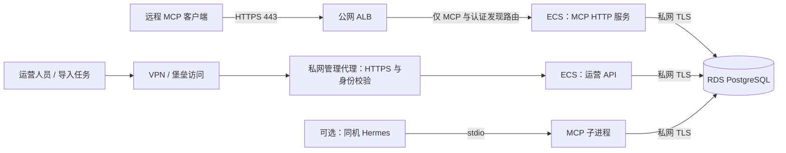

# 阿里云部署规划与恢复记录

> 更新日期：2026-09-14（UTC）。状态：规划文档已完成；云资源与应用改造尚未开始。
> 本次交付是部署规划；尚未创建云资源、修改应用或执行生产迁移。

## 当前恢复入口

- 已完成：仓库核查、官方资料核验、部署架构、数据库维护、接口暴露与鉴权方案、分阶段验收和中断恢复规则；README 已添加入口。
- 当前无进行中的部署操作，没有需要接管的云任务。
- 下一步：实施部署时从 P0 确认地域、预算、域名、客户端和负责人开始，再推进 P1–P6；本次文档任务已完成。
- 恢复方式：先读本文，再执行 `git status --short`、`git log -5 --oneline`，以实际资源和代码状态校对任务表。不要把规划项当成已实现功能，也不要重跑已完成的迁移或资源创建。

## 1. 推荐结论与规划边界

应用只提供套餐推荐及支撑推荐所需的目录维护，不提供直接购买链接、渠道跳转、下单、支付或核销。购买链接生成、展示、跳转和域名白名单校验均不属于应用功能，也不列入开发待办或上线验收。

首期采用 **ECS 容器运行应用 + RDS PostgreSQL 托管数据库 + 公网 HTTPS 入口 + 私网管理入口**。先部署单个推荐服务实例，接受发布时短暂中断和会话重建；完成会话共享后再升级为跨可用区双实例。暂不引入 ACK，减少集群维护成本。所有资源规格、保留周期和指标都是建议值，需要预生产验证，不代表已经采购或达到承诺。

三个重点的结论：

| 重点 | 推荐方案 | 上线前置条件 |
| --- | --- | --- |
| 数据库基础建设 | RDS PostgreSQL 16 起步，私网连接、分角色账号、独立迁移、自动备份与恢复演练 | 所选地域/实例支持目标版本及日志备份，迁移和权限在 RDS 验证通过 |
| MCP 暴露 | 远程客户端使用 `https://mcp.<域名>/mcp`，采用 Streamable HTTP；同机 Hermes 继续使用 stdio | 新增 HTTP transport、入口鉴权、主体与会话归属校验，完成目标客户端互通测试 |
| 运维/运营接口 | `/v1/admin/*` 只经 VPN/堡垒访问的私网入口暴露，仍需身份鉴别和角色授权 | 网关默认拒绝、应用 RBAC、写操作审计；探针和指标单独限制访问 |

待实施时确认：地域与域名、月度预算、实际客户端及其 OAuth 支持、访问人数和峰值并发、是否需要 Hermes、是否接受首期会话丢失、数据库与安全运维负责人。在这些信息明确前按小规模、单地域、受控用户方案推进预生产准备；若要求发布不中断，必须先完成共享会话再上线。

## 2. 已核实的项目现状

| 项目 | 当前实现与部署影响 | 代码依据 |
| --- | --- | --- |
| HTTP 服务 | 默认 `:8080`，业务和运营路由同一监听器；没有认证中间件 | [API 入口](../cmd/api/main.go)、[路由](../internal/adapters/inbound/httpapi/handler.go)、[中间件](../internal/adapters/inbound/httpapi/middleware.go) |
| MCP 服务 | `cmd/mcp` 只运行 `mcp.StdioTransport`，不能通过 ALB 直接访问 | [MCP 入口](../cmd/mcp/main.go) |
| MCP 工具 | 推荐会话、生成推荐、商品目录与搜索，共六个工具；不含套餐发布工具 | [工具注册](../internal/adapters/inbound/mcpserver/server.go) |
| 持久化 | 配置 `APP_DATABASE_URL` 后使用 PostgreSQL；遗漏配置会退回内存 | [运行时装配](../internal/infrastructure/bootstrap/runtime.go) |
| 会话 | 即使配置 PostgreSQL，推荐会话仍在各进程内，默认有效期 30 分钟 | [运行时装配](../internal/infrastructure/bootstrap/runtime.go)、[配置](../internal/infrastructure/config/config.go) |
| 迁移 | 启动时执行 001–005，事务和 advisory lock 串行化；005 还执行 Go 回填逻辑 | [迁移执行器](../internal/adapters/outbound/postgres/migrate.go) |
| 健康检查 | `/healthz` 和 `/readyz` 都固定返回成功，不能反映数据库故障 | [路由与探针](../internal/adapters/inbound/httpapi/handler.go) |
| 容器 | 默认 Dockerfile 只构建 API；本地 Compose 映射 8080/5432，连接关闭 TLS | [Dockerfile](../Dockerfile)、[Compose](../compose.yaml) |
| Hermes | 启动 stdio 子进程；宿主 9119/8642 默认仅绑定回环，已有面板/API 密钥配置 | [Hermes Compose](../compose.hermes.yaml) |

`APP_MCD_MCP_TOKEN` 是上游麦当劳 MCP 凭据，不能作为本服务的入站认证。当前 bootstrap 使用本地维护目录，生产基本链路不需要上游 token；以后启用上游集成时再配置出站权限与凭据。

## 3. 云资源与网络布局



- 一个专用 VPC；预留两个可用区的交换机。首期 ECS 可让 MCP 和 API 使用独立容器与端口；RDS 优先选择支持跨可用区高可用及 PITR 的配置。数据库高可用不等于整个应用高可用。
- 应用起步规格建议 2 vCPU / 4 GiB，RDS 选能满足预生产压测与备份要求的最小合适规格；容量以商品量、导入量、数据库连接与推荐计算压测调整。记录 ECS、RDS、ALB、带宽、日志、备份、KMS 和可选 VPN 的月度报价后再确定预算。
- 公网只提供 ALB 443；证书在入口终止，按网络信任要求启用回源 TLS。ECS 不提供公网业务端口，拉取镜像等出站通过受控 NAT 或云服务私网连接。
- ALB 后端源范围按所选实例的官方网络要求配置，并验证安全组实际生效；管理代理后端仅允许运营 API 端口。VPC 内其他主机也不应绕过鉴权。
- RDS 不申请公网地址；白名单仅放行应用及迁移执行器的私网来源，不开放整个互联网。SSH 只允许堡垒或受控管理来源。
- 镜像存入 ACR，发布按 digest 固定；运行非 root，限制容器 CPU/内存并配置重启策略。Hermes 镜像也固定版本/digest。
- 基础设施建议使用 Terraform 管理，状态存入受限、带版本保护的远端后端，并确认锁机制；状态文件视为敏感信息，禁止提交 Git。控制台应急变更须同步回配置并检查漂移。

### 入口矩阵（目标状态）

| 入口 | 可见范围 | 身份与限制 |
| --- | --- | --- |
| `mcp.<域名>:443/mcp` | 公网受控用户 | OAuth access token；受控试点可使用独立 Bearer key |
| OAuth 元数据/发现路由 | 公网 | 只开放协议要求的必要元数据，登录交给身份服务 |
| `ops.<内网域名>:443/v1/admin/*` | VPN/管理网 | 独立运营身份、角色授权、审计 |
| `/v1/products*`、`/v1/recommendation-sessions*` | 首期不对公网开放 | 如果未来提供 REST 客户端，另立受保护路由和会话归属校验 |
| `/healthz`、`/readyz` | 负载均衡/监控来源 | 不暴露配置或数据库细节 |
| `/metrics`（待实现） | 监控采集端 | 私网来源限制，必要时采集凭据 |
| Hermes 9119/8642（可选） | 回环或管理网 | 面板账号与 API key 独立维护，不视为远程 MCP 地址 |
| PostgreSQL 5432 | 应用/迁移执行器私网 | 数据库角色 + TLS + 白名单 |

网关采用精确的域名、路径和方法白名单，其他请求默认拒绝。仅增加一个运维域名不能隔离权限：公网转发整个 API 服务会同时暴露 `/v1/admin/*`，必须从路由和应用授权两层阻断。

## 4. 数据库基础建设如何维护

### 4.1 职责与配置

阿里云负责所购 RDS 产品范围内的底层设施；项目数据库负责人负责版本选型、账号权限、迁移、容量、备份策略与恢复验收。每次云平台维护升级先查看维护窗口和影响，应用具备短暂断连后的重连能力。

开发、预生产、生产使用独立数据库和凭据，生产优先独立实例。生产启动必须强制要求数据库配置，禁止静默回退内存。配置示意（占位值不可直接部署）：

```text
APP_DATABASE_URL=postgres://<runtime-user>:<url-encoded-password>@<rds-private-host>:5432/meal_recommendation?sslmode=verify-full&sslrootcert=/run/secrets/rds-ca.pem
```

在 RDS 开启 SSL，挂载官方 CA 并验证域名和证书；制定证书到期检查与轮换流程。RDS 支持保护内网连接地址，具体配置按[官方 SSL 文档](https://www.alibabacloud.com/help/en/rds/apsaradb-rds-for-postgresql/configure-ssl-encryption-for-an-apsaradb-rds-for-postgresql-instance)执行。

凭据使用 KMS/凭据管理服务保存，由受限 RAM 实例角色获取并通过受限文件或运行时环境注入；代码目前只读取环境变量，文件读取/密钥刷新需要启动脚本或代码支持。禁止将真实 DSN、token、Terraform 状态、数据库导出提交仓库或写入日志。

建议角色：

| 角色 | 权限边界 |
| --- | --- |
| `meal_migrator` | 拥有应用 schema，执行迁移 DDL、数据回填和必要触发器管理；仅发布任务持有 |
| `meal_api` | 运营业务所需表 DML 与 ID 分配权限；无 DDL、无迁移凭据 |
| `meal_mcp` | 目录查询及推荐链路必要权限；会话 ID 分配仍需要 `next_snowflake_id()` 相关写权限 |
| `meal_readonly` | 故障排查的受限 SELECT，按需访问 |

`next_snowflake_id()` 当前使用默认调用者权限，因此仅授予 EXECUTE 不够，还需核验 `snowflake_state` 的 SELECT/UPDATE 权限及初始化路径。按实际 SQL 最小授权，不为方便直接赋予实例高权限账号。收紧 schema CREATE 和函数默认 PUBLIC EXECUTE；新增表/函数使用一致 owner 与默认授权。迁移 003 包含表锁、函数和触发器操作，必须在目标 RDS 权限模型上验证。

### 4.2 迁移与版本维护

现有迁移已有事务和锁保护，应保留；其问题是与进程启动耦合，并非缺少串行化。启动初始化与外部调用共用默认 12 秒超时，数据回填或锁等待可能超时。

目标发布流程：

1. 增加独立迁移命令，调用现有 `postgres.Migrate`，保留 005 的 Go 回填；不能仅用 `psql` 顺序执行 SQL 文件替代。
2. 应用启动改为检查 schema 兼容性，禁用自动 DDL；独立配置迁移超时、锁等待超时，失败即停止发布。
3. 预生产测试空库安装、现有库升级、第二次执行无副作用、迁移失败回滚和权限最小化。001–005 已应用文件不改写，新变更新增迁移。
4. 生产记录发布版本、镜像 digest、迁移文件校验值和备份标识，先备份再由单个迁移任务执行；查询 `schema_migrations` 确认结果。
5. 使用先扩展、后迁移数据、最后删除旧结构的兼容变更策略；破坏性 DDL 另设维护窗口。当前迁移器在一个事务内执行全部待应用迁移，不可直接放入 `CREATE INDEX CONCURRENTLY`。

代码回滚优先切回兼容旧镜像，不自动执行反向迁移。数据库误写/不兼容变更按恢复流程处理，禁止通过删除 `schema_migrations` 记录强制重跑。

### 4.3 备份、恢复与数据维护

建议目标：目录和运营数据 RPO ≤ 15 分钟、RTO ≤ 2 小时，须以实测确认；内存推荐会话不在数据库恢复范围内。RDS 的日志备份支持保留期内 PITR，基础版不支持日志备份，因此选型必须核验该能力。[官方 PostgreSQL 备份说明](https://www.alibabacloud.com/help/en/rds/apsaradb-rds-for-postgresql/back-up-an-apsaradb-rds-for-postgresql-instance)

- 建议每日自动数据备份、启用日志备份、保留 30 天；实际可选频率/保留时间依所选产品核对。发布前增加手动备份，监控最近成功备份时间与最早/最近可恢复点。
- 每月至少一次恢复到隔离实例，重大迁移前额外演练。验证商品、套餐、发布快照、业务身份、幂等记录、雪花 ID 状态和 schema 版本，同时实际生成推荐；只看到备份成功不算恢复验收。
- 数据恢复顺序：暂停写入及导入任务 → 记录故障时刻与现库备份 → 选择恢复点 → 恢复隔离实例 → 校验并核对恢复点之后的业务写入 → 更新 DSN/凭据 → 重启并验证 → 恢复流量。保留旧库用于比对，避免两库同时写入。记录真实耗时和丢失/补录数据范围。
- 定期观察磁盘增长、连接数、慢 SQL、锁等待、死锁、autovacuum 与表膨胀；容量提前扩容。建议连接数或空间达到 70% 告警，85% 升级处理，后续据基线调整。
- 配置 `sql.DB` 连接池上限、空闲连接和连接寿命（待实现）；API、MCP、迁移任务和可选 Hermes 的总连接预算应小于 RDS 连接限额，并保留运维余量。
- 套餐更新走运营接口的录入、审核、发布/验证/停用流程；发布快照不可变，不通过数据库直接改写。幂等记录清理前明确调用方重试窗口，归档/清理方案另行实现。

## 5. MCP 如何暴露，是否需要鉴权

### 5.1 两种使用模式

**同机 Hermes 模式：**保留现有 stdio 子进程，不开放 MCP 端口。依赖操作系统、容器和 Hermes 入口的身份边界；限制可执行文件与配置写权限。Hermes 面板/API 的鉴权只保护 Hermes，不能自动保护未来新增的 MCP HTTP 入口。

**远程客户端模式（本规划默认目标）：**新增独立 HTTP MCP 入口与镜像构建目标，复用 `mcpserver.New`；现有 `cmd/mcp` 继续支持 stdio。采用 Streamable HTTP，单个 `/mcp` 路径按协商协议处理 POST/GET 和适用的 DELETE，透传所需协议与会话头，验证 Origin。具体协议版本须与当前 Go SDK v1.7.0 和目标客户端联合确认，本规划以 [2025-11-25 transport 规范](https://modelcontextprotocol.io/specification/2025-11-25/basic/transports)作为核验基线，不宣称该版本为最新。

不要将 Hermes 8642 API 或现有 REST API 直接命名为 MCP 地址；它们不等同于本项目的远程 MCP transport。

### 5.2 鉴权决策

远程访问默认必须鉴权：即使目录不是秘密，推荐工具消耗资源且涉及用户会话，匿名开放会带来滥用和越权。

- 面向通用 MCP 客户端：采用 OAuth 授权服务；MCP 作为资源服务器验证签名、issuer、audience、有效期与 scope，提供必要的受保护资源元数据和认证挑战。使用授权码 + PKCE 等规范要求的流程；不自行开发密码登录系统。令牌不得直接透传给其他资源服务器。[MCP 授权规范](https://modelcontextprotocol.io/specification/2025-11-25/basic/authorization)
- 小范围、受控机器客户端试点：可先用每个调用方独立的高强度 Bearer key，通过 HTTPS 的 Authorization 头传递；支持撤销、轮换、失效期和速率配额。只有目标客户端支持自定义头才能采用；这不等于完整的 MCP OAuth 互通方案。
- 本服务 token、运营 token、上游 token 完全分离；禁止 URL 查询参数携带密钥，日志脱敏。CORS 或 IP 白名单不能替代身份校验。
- 设定工具级 scope，例如 `catalog:read` 与 `recommendation:use`（规划值），未知工具和 scope 默认拒绝；MCP 不新增运营写工具。
- 在用例层将登录主体绑定业务会话，创建时不能信任客户端 `userId`，读取、修改和生成推荐都要验证归属。`Mcp-Session-Id` 与业务 session ID 均不能替代认证；增加跨用户访问拒绝测试。

### 5.3 连接与扩容

ALB 和回源服务的空闲/请求超时须覆盖实际长连接行为，验证 SSE 首帧及时到达、持续流式输出、断线重连和客户端取消。现有 API `WriteTimeout=15s` 不宜直接套用于 MCP 流式响应；单独设置 MCP 超时与资源上限。ALB 超时能力与实例类型相关，按[官方监听器文档](https://www.alibabacloud.com/help/en/slb/application-load-balancer/create-and-manage-listeners)核对，并以端到端实测为准。

首期仅一个远程 MCP 实例，进程重启后通知客户端新建业务会话；API 与 MCP 即使连接同一 RDS，也不共享会话，客户端不能跨 transport 接着使用同一个会话。启用多实例前将业务会话改为 PostgreSQL 或 Redis 共享存储，并单独处理 SDK 的协议会话/事件恢复状态。负载均衡粘性不能解决节点故障或重启的数据丢失。

## 6. 运维接口如何暴露

这里区分运营数据管理和技术运维，二者均不进入公网 MCP 路由。

### 6.1 运营数据管理

现有 `/v1/admin/products` 和 `/v1/admin/offers`（含 imports、draft、review、publish、verify、disable）经 VPN 到私网 HTTPS 代理，再到 API 容器。完整语义见[录入 API](offer-ingestion-api.md)。首期可由受控脚本/curl 调用，不要求额外建设管理 UI。

人员使用企业身份服务登录并启用 MFA；无人值守导入任务使用独立服务身份，不能复用人员或 MCP 密钥。代理鉴别身份后，应用也必须验证可信凭据或经验证的签名身份；不能信任客户端随意传入的 `X-User` 等头。

建议应用 RBAC：

| 角色 | 范围 |
| --- | --- |
| 查看者 | 查询商品与套餐 |
| 编辑/导入者 | 创建、修改草稿和录入，不能发布 |
| 审核/发布者 | 审核、发布、验证、停用 |
| 平台运维 | 发布、日志与基础设施管理，不默认获得业务发布权限 |

特别检查 imports/聚合录入是否携带发布状态或触发发布动作，按实际动作授权，不能仅按 URL 将所有导入授予编辑者。审计记录主体、时间、request ID、动作、目标 ID、版本、结果及必要变更摘要；日志避免包含原始密钥或完整敏感请求。使用 Cookie 的管理 UI 还需 CSRF 防护。

### 6.2 技术运维

- `/healthz` 仅表示进程存活，不依赖数据库，避免数据库故障导致重启风暴。
- `/readyz` 改为带短超时的数据库可用性/schema 兼容检查；失败从流量入口摘除。当前固定返回成功的实现是上线阻塞项。
- 增加监控指标或等价采集，指标入口仅监控系统可达；pprof/debug 默认关闭，临时开启也只能走私网。
- JSON 日志汇集到 SLS 或等价日志平台；补 request ID、经过脱敏的主体和工具名。监控 5xx、鉴权失败突增、P95 延迟、MCP 活跃连接、容器重启、RDS 连接/空间/锁等待、备份失败、证书到期与套餐过期情况。
- 起步告警建议：连续 3 次 readiness 失败、5 分钟 5xx 超过 1%（设最小请求数门槛）、最近成功备份超出计划窗口、证书距到期不足 30 天。值班负责人和升级联系人上线前填写，并实际触发一次通知验证。
- RAM 权限按部署、数据库、日志分别授予；使用 ActionTrail 等记录云控制面操作。日志建议保留 30 天、关键运营审计 180 天，按预算与业务要求确定。

## 7. 分阶段任务与验收

状态只允许：待开始 / 进行中 / 阻塞 / 已完成。下表中的“负责人”是待认领角色，不表示已经分配人员；无证据不可标为已完成。

| ID | 任务 | 依赖 | 负责人 | 状态 | 完成证据 |
| --- | --- | --- | --- | --- | --- |
| D0 | 仓库核查、官方资料核验、规划与恢复记录 | 无 | 文档维护者 | 已完成 | 本文与 README 链接；文档校验记录见第 9 节 |
| P0 | 确认地域、预算、域名、客户端、SLO 和负责人 | D0 | 项目负责人 | 待开始 | 决策记录及目标客户端清单 |
| P1 | IaC、VPC、ECS、RDS、ACR、密钥和访问通道 | P0 | 平台运维 | 待开始 | IaC 变更、资源 ID、网络拒绝测试 |
| P2 | 独立迁移、禁用启动 DDL、强制 DB、连接池与 readiness | D0 | 后端/数据库 | 待开始 | RDS 空库和升级测试、最小权限验证 |
| P3 | 远程 MCP transport、身份/会话授权与镜像 | P0 | 后端 | 待开始 | 实际客户端调用、流式/跨用户拒绝测试 |
| P4 | 运营身份、RBAC、私网路由与审计 | P0 | 后端/平台运维 | 待开始 | 权限矩阵测试、审计样例 |
| P5 | 预生产部署、备份恢复、发布回滚与告警演练 | P1–P4 | 平台运维/数据库 | 待开始 | 演练报告、实测 RPO/RTO、镜像 digest |
| P6 | 生产迁移、数据装载、开放 MCP 流量 | P5 | 发布负责人 | 待开始 | 发布记录、完整验收结果 |
| P7 | 共享会话与跨可用区应用副本 | P6；若要求不中断则提前 | 后端/平台运维 | 待开始 | 节点故障后会话连续性测试 |

生产发布顺序：固定代码版本与镜像 → 验证凭据/网络 → 确認备份完成 → 单次迁移 → 启动私网 API/MCP → 通过受控入口装载并审核发布目录 → 探针与端到端检查 → 开放 MCP 路由 → 观察错误率与会话行为。新库无数据时应用存活不等于推荐业务可用。

上线验收清单：

- [ ] 公网仅必要 HTTPS 路由可达，直连 ECS 8080、运营入口及 RDS 5432 均被拒绝；从不受信任 VPC 主机复验。
- [ ] MCP 缺失/过期/错误 audience 凭据被拒绝，scope 不足和跨用户会话访问被拒绝；真实客户端完成初始化、工具发现及推荐。
- [ ] SSE/超时/取消与重连行为通过目标客户端验证；重启后的会话恢复或重建符合已接受约定。
- [ ] 普通 MCP 身份不能调用运营接口，编辑者不能通过导入绕过发布权限；运营写入有可追溯审计。
- [ ] 生产缺少数据库配置会启动失败；断开数据库后 readiness 失败、liveness 保持正常，恢复连接后可服务。
- [ ] 迁移只由独立任务执行，应用无 DDL 权限；空库和存量库迁移、不可变快照与幂等重试通过验证。
- [ ] 真实 RDS 恢复与旧镜像回滚演练完成，指标满足目标或已明确调整。
- [ ] 数据库/应用资源压测有余量，证书续期、密钥轮换与告警通知已验证。

## 8. 中断恢复与持续更新规则

本文是此部署任务的唯一状态入口；不要用其他功能计划的历史记录替代本表。每完成一个阶段、遇到阻塞或准备中断时，立即更新顶部恢复入口、任务状态与本节检查点。若任务持续多轮，至少每轮结束更新一次；代码/架构改变时同步改写相关章节。

每个实施检查点记录以下字段（仅记录密钥引用名，不记录值）：

```text
时间（UTC）：
任务 ID / 负责人 / 状态：
代码 commit / 工作区未提交变更 / 镜像 digest：
环境 / 地域 / 资源 ID / IaC 状态位置：
已执行动作及结果：
数据库 schema 版本 / 备份 ID / 恢复点：
测试或日志证据位置：
未完成项 / 阻塞原因：
下一条可执行动作 / 重试条件 / 回滚步骤：
```

恢复顺序：

1. 阅读顶部与最后一个检查点，检查 Git 工作区和最新提交，保留已有修改。
2. 对照云资源 ID、镜像 digest、实际运行进程和 `schema_migrations` 核对状态；只做查询，先判断上次动作是否已完成。
3. IaC 中断：先检查执行日志、远端状态和锁持有者，确认无运行任务再处理残留锁；已有资源先导入/对账，避免重复创建。
4. 迁移中断：确认旧任务已退出，检查锁和版本表。现有迁移事务未提交会回滚；如已提交则按版本跳过。修复原因后用同一版本执行器重试，不手工伪造成功记录。
5. 发布中断：确定当前实际镜像和路由；新版本未通过验收则保持/恢复旧兼容镜像。若 schema 不兼容，暂停写入并进入第 4.3 节恢复流程。
6. 导入中断：核对原请求内容、幂等键和服务端结果后重试；不能更换键盲目重放。旧批量导入如有部分成功，以实际逐项结果对账，不能假定整个批次原子。
7. 更新检查点后，从第一个未完成任务继续；最后重跑受此次中断影响的验收，不无条件重做全部基础设施。

## 9. 本次编写记录

- 2026-09-14：建立初始恢复记录；确认 stdio-only、无运营鉴权、内存会话、启动迁移和固定 readiness 等现状。
- 2026-09-14：核验阿里云 RDS TLS/备份、ALB 超时与 MCP transport/authorization 官方资料；完成架构、权限、数据库维护、上线步骤与中断恢复规划。
- 文档校验：README 与本文的本地链接检查通过，`git diff --check` 通过；本次没有改动应用代码，不运行应用测试，不将预生产验收记作已通过。

- 2026-09-14：按用户确认收紧功能边界，仅提供套餐推荐；购买链接、渠道跳转及相关白名单校验不属于应用开发或部署验收范围。本次仅更新文档，现有兼容字段未改动。
