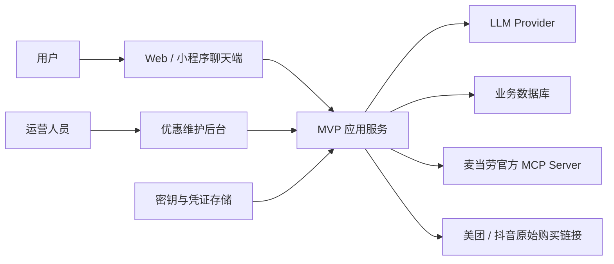
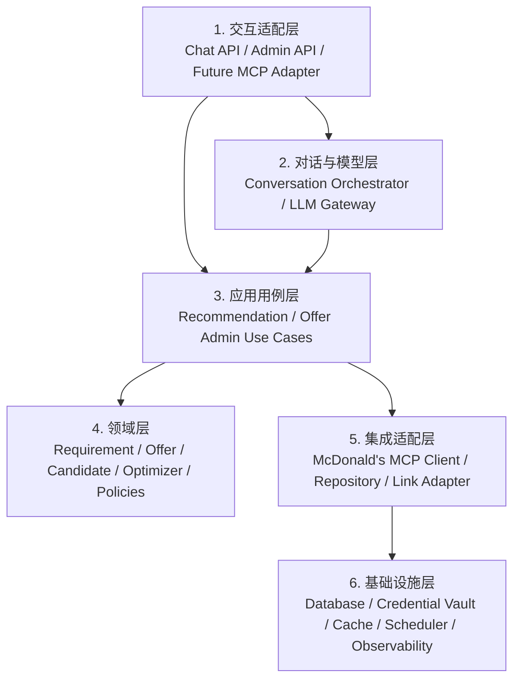
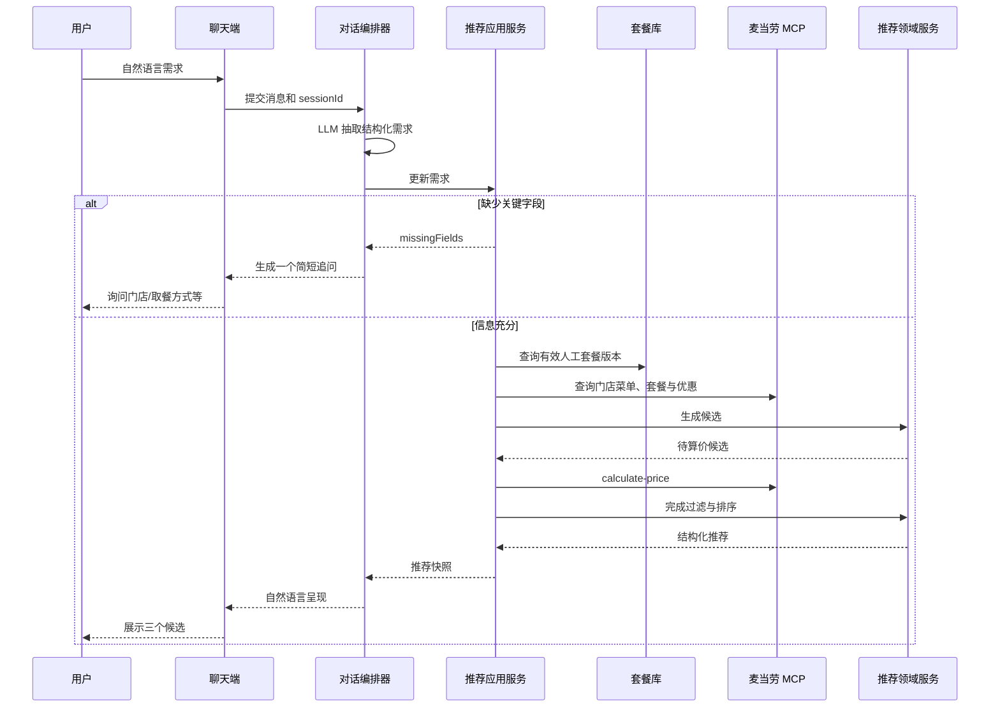
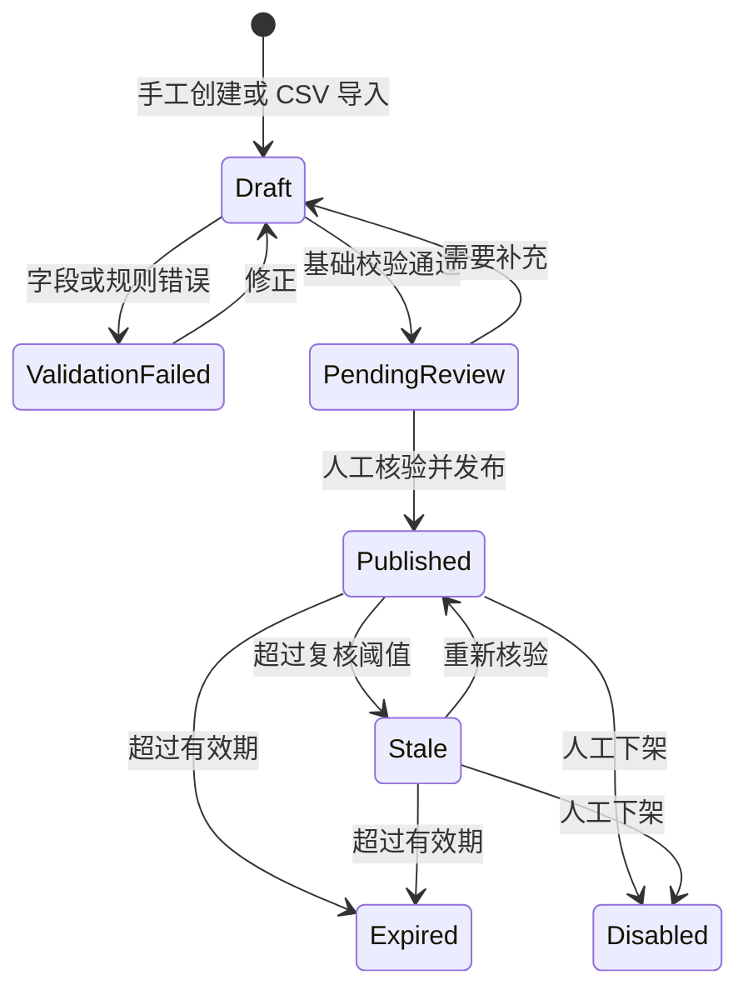
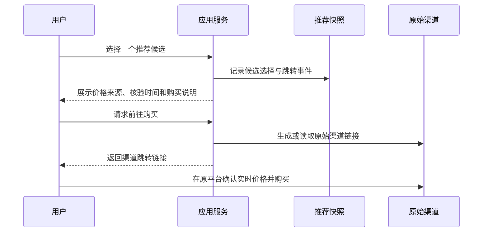
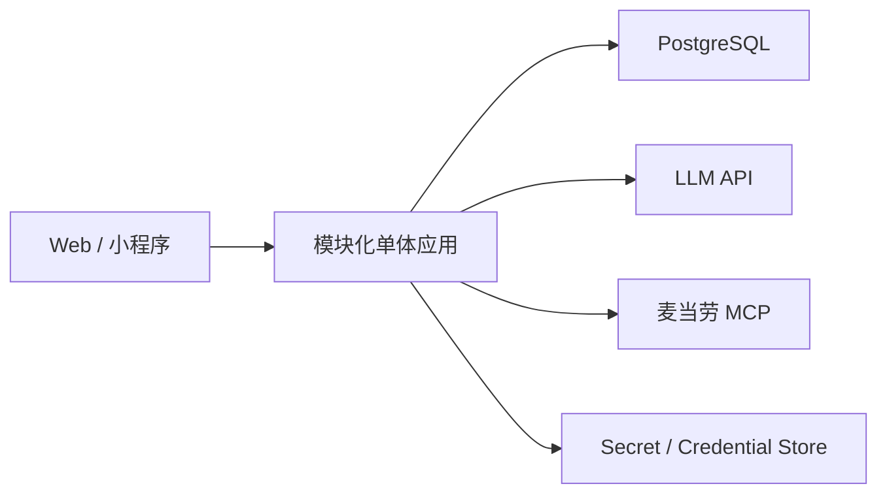

# 跨渠道智能点餐推荐服务：MVP 架构设计

| 属性 | 内容 |
| --- | --- |
| 文档状态 | Draft / 待评审 |
| 版本 | 0.2 |
| 日期 | 2026-08-15 |
| 阶段 | MVP 设计阶段，不包含代码实现 |
| 核心渠道 | 麦当劳官方渠道、美团/抖音等人工维护渠道 |

## 1. 文档目的

本文定义一个通过少量对话理解用户饮食需求，并在麦当劳官方菜单与人工维护的第三方优惠套餐之间，筛选合适点餐组合的 MVP 服务。

本文重点回答：

- 服务如何分层，各层承担什么职责。
- LLM、领域逻辑、人工套餐库和麦当劳 MCP Server 如何协作。
- 如何表示套餐、可选项、适用门店、价格与有效期。
- 如何完成需求收集、组合搜索、推荐解释和购买跳转。
- MVP 做什么、不做什么，以及未来如何扩展成对外 MCP Server。

本文不包含具体业务代码、数据库迁移脚本、部署脚本或 UI 视觉设计。

## 2. 背景与问题定义

用户希望表达自然语言需求，例如：

> 我一个人吃，必须有巨无霸和麦旋风，预算 40 元，不想喝含糖饮料，也不希望为了便宜拿一堆不想吃的小食。

系统需要在以下供给中比较：

1. 麦当劳官方渠道的实时菜单、套餐、账户优惠券与实际算价。
2. 美团、抖音等第三方平台上由运营人员维护的低频变化套餐。
3. 必要时由多个购买项组成的混合方案，例如“第三方巨无霸套餐券 + 麦当劳官方单点麦旋风”。

系统优化目标不是单纯寻找标价最低的套餐，而是在满足必须餐品、预算、忌口、人数、门店和时段等硬约束后，平衡：

- 最终实付金额。
- 用户真正想吃的餐品覆盖度。
- 不想要餐品带来的浪费。
- 跨平台购买与核销成本。
- 价格和套餐信息的可信度、时效性。

## 3. 目标与非目标

### 3.1 MVP 目标

- 用 2～3 轮对话收集足够的点餐条件。
- 将用户自然语言转换为结构化需求。
- 支持人工创建、批量导入、核验、发布和下架第三方优惠套餐。
- 使用麦当劳官方 MCP 查询当前门店菜单、套餐详情、优惠券和实时价格。
- 生成并比较单渠道和有限的跨渠道组合。
- 返回“最低实付”“最符合口味”“性价比最高”三个可解释结果。
- 所有渠道只提供原平台购买跳转，不在本服务内创建订单。
- 保留足够的推荐快照与审计信息，以解释当时为什么给出该结果。

### 3.2 MVP 非目标

- 自动抓取或逆向美团、抖音消费者接口。
- 自动购买、支付或核销第三方团购券。
- 通过麦当劳 MCP 或其他渠道创建订单、支付、查询订单状态。
- 获取用户在美团、抖音的个人优惠券与结算价。
- 支持麦当劳以外的餐饮品牌。
- 使用机器学习训练个性化排序模型。
- 微服务、消息队列、复杂数据仓库和多 Agent 协作。
- 第一阶段将本服务对外暴露为 MCP Server。

## 4. 关键架构决策

### 4.1 采用模块化单体

MVP 使用一个可独立部署的应用服务，内部按清晰模块和依赖方向分层。这样可以降低部署和运维复杂度，同时为未来拆分保留边界。

### 4.2 麦当劳 MCP 仅作为只读数据源

本服务通过 MCP Client SDK 调用麦当劳官方远程 MCP Server，只使用菜单、套餐详情、优惠券和算价等只读能力。聊天前端不直接访问麦当劳 MCP，也不持有麦当劳 Token。MVP 不调用创建订单、支付或订单查询工具。

如未来需要让其他 MCP Host 调用本服务，可在最外层新增 MCP Server Adapter，而不改动领域层和应用层。

### 4.3 MCP Prompt 不是核心契约

LLM 的结构化输入由 Tool Schema 或模型结构化输出约束；服务端对所有输入再次校验。MCP Prompt 可在未来作为可选对话模板，但不能替代参数校验、商品映射和业务规则。

### 4.4 LLM 不负责价格和组合计算

LLM 只负责：

- 识别用户意图和偏好。
- 对缺失信息生成自然语言追问。
- 将服务端返回的结构化结果解释给用户。

服务端确定性逻辑负责：

- 商品名称映射。
- 套餐适用性校验。
- 候选组合生成。
- 真实价格查询。
- 硬约束过滤和排序。

### 4.5 第三方套餐是人工维护的价格快照

第三方套餐价格不是实时结算价，必须记录来源、核验时间、有效期和可信度。推荐结果要明确区分：

- 麦当劳 MCP 实时算价。
- 当日人工核验价。
- 历史人工核验价。
- 用户补充但尚未复核的价格。

## 5. 系统上下文



外部依赖：

- LLM Provider：偏好抽取、追问与结果表述。
- 麦当劳 MCP Server：官方实时菜单、优惠和算价能力。
- 数据库：标准餐品、人工优惠、推荐快照与管理记录。
- 密钥与凭证存储：麦当劳用户 Token、LLM API Key 等敏感信息。

## 6. 分层架构



依赖原则：

- 外层可以依赖内层，领域层不依赖 Web 框架、数据库、MCP SDK 或具体 LLM SDK。
- 应用层通过 Port 接口使用数据库、LLM 和麦当劳 MCP。
- 集成层实现 Port，并将外部协议转换为内部领域对象。
- 外部数据进入领域层前必须完成校验、单位统一和错误映射。

### 6.1 交互适配层

职责：

- 接收聊天端和运营后台请求。
- 完成身份认证、基础格式校验和请求限流。
- 将 HTTP 请求转换为应用用例参数。
- 将应用结果转换为 HTTP/SSE 响应。
- 未来可新增 MCP Server Adapter，对外暴露同一应用能力。

建议模块：

- `Chat API Adapter`
- `Admin API Adapter`
- `Future MCP Server Adapter`，非 MVP

本层不包含推荐算法、套餐规则和第三方价格逻辑。

### 6.2 对话与模型层

职责：

- 管理一轮或多轮对话上下文。
- 调用 LLM 抽取结构化需求。
- 判断 LLM 输出是否符合 Schema。
- 根据应用层返回的缺失字段生成追问。
- 将结构化推荐结果生成用户可理解的说明。

建议模块：

- `ConversationOrchestrator`
- `RequirementExtractor`
- `ClarificationComposer`
- `RecommendationPresenter`
- `LLMGateway`

重要约束：

- 不向 LLM 发送麦当劳 Token、手机号或地址详情等敏感参数。
- 不接受 LLM 自行生成的价格、商品编码、门店编码或优惠券 ID 作为事实。
- 对模型输出做 Schema 校验；失败时重试一次或退回安全追问。

### 6.3 应用用例层

应用层负责用例编排和事务边界，不实现具体评分公式。

核心用例：

#### `StartRecommendationSession`

- 创建推荐会话。
- 保存渠道范围、默认城市和客户端信息。
- 返回会话 ID。

#### `HandleUserMessage`

- 合并当前消息与已有需求。
- 调用需求抽取。
- 校验是否缺少影响推荐的关键字段。
- 缺失时返回追问；完整时触发推荐计算。

#### `GenerateRecommendations`

- 获取有效人工优惠。
- 获取麦当劳当前门店菜单和相关优惠。
- 调用领域服务生成候选。
- 对需实时算价的麦当劳候选调用 `calculate-price`。
- 过滤无效候选并排序。
- 保存推荐快照。

#### `ImportOffers`

- 接收表单或 CSV 导入数据。
- 建立导入批次并执行字段校验。
- 生成草稿，不自动发布。

#### `ReviewAndPublishOffer`

- 完成商品别名映射、选择组校验、门店范围和有效期校验。
- 记录核验人和核验时间。
- 发布套餐版本。

#### `ExpireOffers`

- 定期将超过有效期的套餐置为过期。
- 将长期未复核但尚未到期的套餐标记为陈旧。

### 6.4 领域层

领域层是系统核心，包含业务实体、值对象、领域服务和策略。

#### 核心实体

- `RecommendationSession`：一次对话推荐的生命周期。
- `DiningRequirement`：结构化用餐需求。
- `CanonicalProduct`：渠道无关的标准餐品。
- `Offer`：一个渠道可购买的套餐或单品。
- `OfferVersion`：套餐在某次发布后的不可变版本。
- `OfferComponent`：固定餐品或可选餐品组成。
- `ChoiceGroup`：几选几、可加价等选择规则。
- `PurchaseLeg`：一次需要在某个渠道完成的购买动作。
- `CandidateCombination`：一个或多个 PurchaseLeg 组成的候选方案。
- `PriceQuote`：带来源、时间和可信度的价格。
- `RecommendationSnapshot`：推荐时使用的输入、数据版本和输出。

#### 领域服务

- `ProductResolver`：将“巨无霸汉堡”等名称映射到标准商品。
- `OfferEligibilityPolicy`：判断门店、城市、时间、会员和限购条件。
- `RequirementCoverageEvaluator`：计算候选是否覆盖必须项。
- `CandidateGenerator`：生成单渠道和受控跨渠道组合。
- `CandidatePricingService`：汇总各购买腿价格和费用。
- `WasteEvaluator`：计算不需要餐品数量与浪费惩罚。
- `CandidateRanker`：硬约束过滤、Pareto 去重和排序。
- `RecommendationReasonBuilder`：产生不依赖 LLM 的结构化推荐理由。

### 6.5 集成适配层

#### 麦当劳 MCP Adapter

本适配器作为远程 MCP Client，封装：

- MCP 初始化、协议协商与会话处理。
- Bearer Token 注入。
- `query-nearby-stores`
- `query-store-coupons`
- `query-meals`
- `query-meal-detail`
- `calculate-price`

对应用层暴露稳定的内部 Port，例如：

```text
OfficialCatalogPort
OfficialCouponPort
OfficialPricingPort
```

适配器负责将 MCP 返回的文本或结构化内容转换为内部对象，并统一处理：

- 401：Token 无效或过期。
- 404：MCP Session 失效，重新初始化。
- 429：触发限流，退避后有限重试。
- 超时与网络错误。
- 数据字段缺失或格式变化。

#### Repository Adapters

- `OfferRepository`
- `CanonicalProductRepository`
- `RecommendationSessionRepository`
- `RecommendationSnapshotRepository`
- `CredentialRepository`

#### LLM Adapter

将不同模型供应商统一成：

```text
extractRequirement(messages, schema)
composeClarification(missingFields, context)
presentRecommendations(structuredResult, locale)
```

### 6.6 基础设施层

职责：

- 关系数据库与事务。
- 凭证加密和解密。
- 短时缓存。
- 到期任务调度。
- 日志、指标和追踪。
- 配置管理与环境隔离。

MVP 推荐：

- 一个应用进程。
- 一个 PostgreSQL 数据库；本地原型可用 SQLite，但正式 MVP 建议直接使用 PostgreSQL。
- 进程内短时缓存；暂不引入 Redis。
- 同一应用内的定时任务完成套餐过期和陈旧标记。
- 对象存储仅在需要保留套餐截图证据时引入。

## 7. 领域数据模型

### 7.1 标准餐品

`canonical_products`

| 字段 | 说明 |
| --- | --- |
| `id` | 内部稳定 ID，如 `BIG_MAC` |
| `name` | 标准展示名称 |
| `category` | 汉堡、甜品、饮料、小食等 |
| `attributes` | 含糖、含咖啡因、辣味等属性 |
| `active` | 是否继续用于新数据 |

`product_aliases`

| 字段 | 说明 |
| --- | --- |
| `source` | mcd、meituan、douyin、manual |
| `alias` | 渠道原始名称 |
| `canonical_product_id` | 标准餐品 ID |
| `confidence` | 自动映射置信度 |
| `review_status` | 待审核、已确认、已拒绝 |

### 7.2 人工优惠套餐

`offers`

| 字段 | 说明 |
| --- | --- |
| `id` | 套餐逻辑 ID |
| `source` | meituan、douyin、other |
| `external_id` | 可选的原平台 ID |
| `status` | draft、published、stale、expired、disabled |
| `current_version_id` | 当前发布版本 |
| `created_at` | 创建时间 |

`offer_versions`

| 字段 | 说明 |
| --- | --- |
| `id` | 不可变版本 ID |
| `offer_id` | 所属套餐 |
| `title` | 原平台套餐标题 |
| `sale_price` | 人工核验售价，统一以分存储 |
| `original_price` | 原价，可选 |
| `price_source_type` | manual_verified、user_reported |
| `valid_from` / `valid_until` | 售卖或使用有效期 |
| `valid_time_rules` | 时段、星期和不可用日期 |
| `purchase_limit` | 限购数量 |
| `member_only` / `new_user_only` | 资格限制 |
| `redemption_mode` | voucher、direct_order |
| `purchase_url` | 原平台链接 |
| `verified_at` / `verified_by` | 最近核验信息 |
| `evidence_ref` | 截图或原始页面证据引用 |

`offer_components`

| 字段 | 说明 |
| --- | --- |
| `offer_version_id` | 套餐版本 |
| `canonical_product_id` | 固定餐品，可为空 |
| `quantity` | 数量 |
| `choice_group_id` | 属于某个选择组时填写 |
| `extra_price` | 选择该项的加价 |

`choice_groups`

| 字段 | 说明 |
| --- | --- |
| `id` | 选择组 ID |
| `name` | 如“小食三选一” |
| `min_select` / `max_select` | 选择数量规则 |

`offer_scopes`

| 字段 | 说明 |
| --- | --- |
| `offer_version_id` | 套餐版本 |
| `scope_type` | nationwide、city、store_list、text_only |
| `city_code` | 城市范围 |
| `external_store_ids` | 已知门店 ID |
| `scope_description` | 原平台适用范围说明 |

### 7.3 推荐会话与快照

`recommendation_sessions`

| 字段 | 说明 |
| --- | --- |
| `id` | 会话 ID |
| `user_id` | 可为空的用户标识 |
| `state` | collecting、ready、computing、completed、expired |
| `requirement_json` | 当前结构化需求 |
| `created_at` / `expires_at` | 生命周期 |

`recommendation_snapshots`

| 字段 | 说明 |
| --- | --- |
| `id` | 快照 ID |
| `session_id` | 所属会话 |
| `requirement_json` | 当次计算需求 |
| `offer_version_ids` | 使用的人工套餐版本 |
| `official_data_timestamp` | 官方数据查询时间 |
| `candidate_json` | 候选及得分 |
| `selected_candidate_id` | 用户选择结果，可为空 |

推荐结果必须引用不可变的 `offer_version_id`，避免后台修改套餐后无法解释历史推荐。

## 8. 结构化用餐需求

建议领域模型：

```json
{
  "people": 1,
  "orderMode": "pickup",
  "location": {
    "city": "上海市",
    "storeCode": null,
    "storeKeyword": "中山公园"
  },
  "mustHave": [
    {"query": "巨无霸", "quantity": 1},
    {"query": "麦旋风", "quantity": 1}
  ],
  "niceToHave": [],
  "exclude": ["含糖饮料"],
  "budget": {
    "amount": 4000,
    "currency": "CNY"
  },
  "objectives": {
    "price": 0.9,
    "preferenceMatch": 1.0,
    "avoidWaste": 0.8,
    "convenience": 0.5
  }
}
```

设计要求：

- 金额在服务端统一以分存储。
- LLM 只产生商品自然语言 `query`，由 `ProductResolver` 映射标准 ID。
- 未明确的信息保持未知，不由模型擅自补全。
- 位置、取餐方式或必须项不足以计算时，应用层返回缺失字段。
- 用户后续消息以 Patch 方式更新需求，而不是完全覆盖已有需求。

## 9. 套餐与候选组合模型

一个候选可以包含一个或多个购买腿：

```text
CandidateCombination
  ├── PurchaseLeg: 抖音巨无霸套餐券
  └── PurchaseLeg: 麦当劳官方麦旋风单品
```

每个 `PurchaseLeg` 必须记录：

- 渠道与套餐版本。
- 固定餐品和最终选择项。
- 价格来源与核验时间。
- 购买链接或官方购物车结构。
- 适用门店、时段和资格限制。
- 是否需要另一平台购买、现场核销或二次选择。

MVP 限制：

- 一个候选最多包含两个购买腿。
- 最多允许一个第三方套餐腿和一个麦当劳官方补购腿。
- 不生成两个不同第三方平台混购的候选。
- 不假设第三方券和麦当劳账户券可以叠加。
- 不假设两个渠道的门店范围相同，适用性不明确时降低可信度或不推荐。

## 10. 推荐算法设计

### 10.1 输入

- `DiningRequirement`
- 当前有效的人工 `OfferVersion`
- 麦当劳当前门店可售菜单和相关套餐详情
- 当前用户可用麦当劳优惠券
- 实时麦当劳价格报价
- 评分策略版本

### 10.2 处理阶段

#### 阶段 A：标准化与资格过滤

- 商品名称映射为标准餐品。
- 过滤过期、禁用、门店不匹配和时段不匹配的套餐。
- 标记会员、新客、限购等尚未验证条件。
- 排除无法解释套餐组成的低质量数据。

#### 阶段 B：候选生成

生成以下候选：

1. 单个人工套餐覆盖全部需求。
2. 人工套餐 + 一个麦当劳官方补购项。
3. 麦当劳官方套餐经过允许的选择项替换。
4. 麦当劳官方单品组合。
5. 麦当劳官方套餐 + 官方单品。

仅对包含必须项或接近覆盖必须项的候选继续计算，避免全菜单暴力组合。

#### 阶段 C：实时算价

- 人工套餐使用已发布版本价格。
- 麦当劳候选调用 `calculate-price`。
- 对失败候选记录原因并移出可购买结果。
- 推荐展示前记录报价时间。

#### 阶段 D：硬约束过滤

硬约束包括：

- 必须餐品数量满足。
- 明确排除项不出现，或能被允许替换。
- 预算上限满足。
- 门店、时段、取餐方式可用。
- 购买数量和资格约束满足。

#### 阶段 E：评分与去重

概念评分：

```text
score
= must-have coverage reward
+ nice-to-have reward
- effective price penalty
- unwanted item penalty
- waste penalty
- cross-channel friction penalty
- stale data penalty
- eligibility uncertainty penalty
```

其中：

```text
effective price
= quoted or verified purchase price
+ delivery and packaging fee
+ required supplement items
+ mandatory option surcharge
```

先构造 Pareto 前沿，去除在价格、满足度和便利性上均被另一候选支配的方案，再分别选出：

- 最低实付。
- 最符合口味。
- 性价比最高。

三个标签可能指向同一个候选；此时应返回更少但有实质差异的结果，而不是重复展示。

### 10.3 输出

领域层输出结构化结果：

```json
{
  "status": "completed",
  "recommendations": [
    {
      "label": "best_match",
      "candidateId": "candidate-1",
      "totalPrice": 3850,
      "priceConfidence": "live",
      "coveredRequirements": ["BIG_MAC", "MCFLURRY_ANY"],
      "unwantedItems": [],
      "purchaseLegs": [],
      "reasons": [],
      "warnings": []
    }
  ]
}
```

LLM 只将该结果转换为自然语言，不修改价格、商品组成和警告。

## 11. 关键业务流程

### 11.1 推荐对话流程



### 11.2 人工套餐导入流程



发布检查：

- 标题、价格、来源链接完整。
- 每个固定餐品或选择项已映射标准餐品。
- 选择组满足“几选几”约束。
- 有效期和门店范围已填写。
- 原始证据可追溯。
- 核验人和核验时间已记录。

### 11.3 推荐结果导流流程



控制要求：

- 本服务不创建订单、不提交支付，也不代替原平台核销。
- 跳转前明确展示价格来源、最近核验时间和适用条件。
- 麦当劳官方候选的跳转目标为官方渠道页面，而不是调用 MCP 创建订单。
- 用户必须在原平台再次确认实时价格、门店和库存。
- 跳转链接只允许来自渠道域名白名单。

## 12. API 边界设计

以下是逻辑契约，不是最终代码定义。

### 12.1 用户侧 API

#### 创建推荐会话

```text
POST /v1/recommendation-sessions
```

输入：可选的城市、门店、取餐方式。

输出：`sessionId`、初始状态。

#### 提交消息

```text
POST /v1/recommendation-sessions/{sessionId}/messages
```

输入：用户消息、客户端消息 ID。

输出之一：

- `needs_clarification` 与一个追问。
- `computing` 与流式进度。
- `completed` 与结构化推荐。

#### 获取推荐快照

```text
GET /v1/recommendation-sessions/{sessionId}/recommendations/latest
```

### 12.2 运营侧 API

```text
POST /v1/admin/offers/imports
POST /v1/admin/offers
PUT  /v1/admin/offers/{offerId}/draft
POST /v1/admin/offers/{offerId}/review
POST /v1/admin/offers/{offerId}/publish
POST /v1/admin/offers/{offerId}/verify
POST /v1/admin/offers/{offerId}/disable
GET  /v1/admin/offers?status=stale
```

运营接口必须使用独立角色权限，并记录审计日志。

### 12.3 未来 MCP Server 接口

非 MVP。未来可将应用用例包装为：

```text
recommend-meal
get-offer-detail
```

该 Adapter 只负责 MCP Tool Schema 与应用 DTO 的转换，不复制推荐逻辑。

## 13. MCP Client 通信设计

麦当劳官方 MCP 使用远程 Streamable HTTP。连接配置：

```text
Endpoint: https://mcp.mcd.cn
Authorization: Bearer <user-mcd-token>
Supported protocol: 2025-06-18 及以前，以官方文档为准
```

连接生命周期：

1. 从凭证存储读取当前用户 Token。
2. 创建用户隔离的 MCP Client。
3. 完成初始化和协议协商。
4. 记录服务端返回的 Session ID，并由 SDK 在后续请求携带。
5. 执行 Tools 调用。
6. 会话失效时重新初始化。
7. 空闲超时或请求完成后释放连接。

MVP 可以按用户短时复用 MCP Client，但不得跨用户复用带身份的 Session。具体空闲时间配置化，并以麦当劳实际行为压测后确定。

MVP 只允许调用只读查询和算价工具。`create-order`、`query-order` 及其他交易或订单相关工具不进入允许列表，即使上游 MCP Server 暴露了这些能力也不得调用。

参考：

- [麦当劳 MCP 文档](https://open.mcd.cn/mcp/doc)
- [MCP 2025-06-18 Streamable HTTP](https://modelcontextprotocol.io/specification/2025-06-18/basic/transports)

## 14. 缓存与数据新鲜度

### 14.1 人工套餐

- 发布版本进入数据库后可长期读取。
- 到期任务自动标记 `expired`。
- 超过复核阈值标记 `stale`，阈值按渠道配置。
- `stale` 套餐默认不参与“最低价保证”，可在结果中降权展示。
- 每次修改产生新版本，不覆盖历史版本。

### 14.2 麦当劳官方数据

- 门店公共菜单可做短时缓存，缓存键包含门店、取餐方式和餐段。
- 用户优惠券不得进入跨用户共享缓存。
- `calculate-price` 结果只用于当前推荐或短时预览，不作为长期价格。

### 14.3 推荐快照

快照保存：

- 用户需求版本。
- 人工套餐版本 ID。
- 官方数据查询时间。
- 报价来源与报价时间。
- 评分策略版本。
- 候选被过滤或入选的原因。

## 15. 错误处理与降级

| 场景 | 系统行为 |
| --- | --- |
| LLM 输出不符合 Schema | 进行一次受控重试；仍失败则返回明确追问 |
| 商品名称无法映射 | 询问用户或进入运营别名待审核队列 |
| 麦当劳 Token 过期 | 停止官方个性化查询，提示重新连接 |
| 麦当劳 MCP 超时 | 有限重试；失败后只返回人工套餐并标注官方渠道暂不可用 |
| MCP 429 | 指数退避，不进行大范围暴力算价 |
| 套餐已过期 | 不参与推荐 |
| 套餐已陈旧 | 降权并标明上次核验时间 |
| 第三方门店范围不明确 | 标记“需在原平台确认门店”，必要时不列为首选 |
| 用户跳转后价格变化 | 以原平台结算页为准，并提示推荐价的查询或核验时间 |

## 16. 安全与隐私

### 16.1 凭证

- 麦当劳 Token 仅保存在服务端加密凭证存储。
- 数据库只存凭证引用或加密值，不以明文写日志。
- Token 不发送给 LLM，不返回前端，不嵌入推荐快照。
- 不同用户的 MCP Client 和 Session 完全隔离。

### 16.2 敏感数据

- 推荐算法原则上只使用城市、门店和取餐方式，不采集完整配送地址或手机号。
- 日志对 Token、用户标识和渠道跳转参数做脱敏。

### 16.3 有副作用操作

- MVP 只执行查询、推荐、后台套餐维护和渠道跳转。
- 不通过麦当劳 MCP 或其他渠道创建订单、支付、退款或核销。
- 用户在原平台自行确认实时价格、门店、库存并完成交易。

### 16.4 运营安全

- 套餐创建、发布、下架权限分离可作为后续增强；MVP 至少区分普通用户和运营管理员。
- 所有套餐发布和修改记录操作人、时间、变更前后内容。
- 原始购买链接限制为允许的渠道域名，防止后台录入恶意链接。

## 17. 可观测性

### 17.1 核心指标

- 推荐会话完成率。
- 平均追问轮数。
- 推荐计算耗时及各外部调用耗时。
- 麦当劳 MCP 成功率、401、429 和超时率。
- 候选数量、硬约束淘汰比例。
- 人工套餐陈旧率和过期率。
- 推荐点击率、候选选择分布。
- 推荐结果到原渠道的跳转率。

### 17.2 日志与追踪

- 每个用户请求生成 `traceId`。
- 外部 MCP 调用记录工具名、耗时和结果状态，不记录敏感参数全文。
- 推荐快照记录评分策略版本，支持复现。
- 管理后台变更写入审计日志。

## 18. 性能与容量原则

MVP 不预设大规模流量，但需避免明显不可扩展设计：

- 先按门店、时段和必须项裁剪套餐，再生成组合。
- 只对入围的少量麦当劳候选调用实时算价。
- 单次推荐设置候选和 MCP 调用上限。
- 外部调用设置超时、重试次数和整体截止时间。
- 推荐计算应支持取消；用户修改条件后终止旧计算结果的展示。
- 数据库查询围绕 `status`、有效期、城市、来源建立索引。

具体延迟目标和并发目标应在完成原型调用测试后确定，不在设计阶段虚构 SLO。

## 19. 测试策略

虽然本阶段不写代码，但实现阶段至少需要：

### 19.1 领域单元测试

- 必须项覆盖。
- 选择组几选几规则。
- 排除项和浪费计算。
- 跨渠道腿数限制。
- 预算和门店资格过滤。
- Pareto 去重和三个推荐标签。

### 19.2 契约测试

- 麦当劳 MCP Tool 输入输出适配。
- JSON 与 SSE 两类响应。
- 401、404、429、超时和结构变化。
- LLM 结构化输出 Schema。
- CSV 导入字段和错误报告。

### 19.3 场景测试

建立固定场景集：

- 必须巨无霸和麦旋风，套餐不能替换麦旋风。
- 套餐允许加价替换麦旋风。
- 官方单点比第三方套餐更符合需求。
- 第三方套餐标价低但包含大量不想要餐品。
- 第三方套餐过期或门店不适用。
- 官方 MCP 不可用时的降级。
- 用户跳转原平台后发现价格变化。

### 19.4 安全测试

- Token 不出现在日志、模型输入和 API 响应中。
- 普通用户不能访问运营 API。
- 恶意购买链接不能发布。

## 20. 部署拓扑

MVP 最小部署：



建议环境：

- `local`：本地数据库、Mock MCP、测试模型配置。
- `staging`：隔离数据库和测试用户 Token，用于真实 MCP 联调。
- `production`：独立密钥、数据库和审计策略。

第一阶段不引入独立缓存服务、消息队列或 Kubernetes。只有在实际指标证明需要后再扩展。

## 21. 模块目录建议

这是实现阶段的逻辑目录参考，不代表已经开始编码：

```text
src/
  presentation/
    chat-api/
    admin-api/
    future-mcp-adapter/
  conversation/
    orchestrator/
    requirement-extractor/
    presenters/
  application/
    recommendation/
    offer-admin/
  domain/
    requirement/
    catalog/
    offer/
    recommendation/
  integrations/
    mcdonalds-mcp/
    llm/
    persistence/
    credentials/
  infrastructure/
    database/
    scheduler/
    observability/
```

约束：

- `domain` 不引用其他目录中的框架实现。
- `application` 只依赖领域模型和 Port。
- `integrations` 实现 Port。
- `presentation` 不直接访问数据库或 MCP SDK。

## 22. MVP 迭代计划

### 阶段 0：设计确认

- 确认用户端形态：Web、微信小程序或其他入口。
- 确认首批城市和门店范围。
- 确认人工套餐录入模板。
- 确认是否允许跨渠道补购候选。
- 确认麦当劳 Token 的用户连接方式。

### 阶段 1：无交易推荐闭环

- 人工套餐库与 CSV 导入。
- 标准餐品和别名管理。
- 对话需求抽取。
- 麦当劳 MCP 菜单、详情、优惠和算价。
- 三类推荐结果。
- 第三方平台跳转。

### 阶段 2：运营效率

- 陈旧套餐提醒。
- 半自动商品别名建议。
- 分享链接或截图辅助录入。
- 套餐覆盖率和推荐效果看板。

### 阶段 3：数据自动化

- 评估美团联盟等正式 API。
- 评估抖音商家/服务商授权。
- 用正式 Adapter 补充或替代部分人工套餐维护。

### 阶段 4：平台化

- 增加本服务的 MCP Server Adapter。
- 扩展其他餐饮品牌。

## 23. 待确认事项

以下问题不阻塞架构，但在实现前需要产品决策：

1. MVP 首发客户端是 Web、微信小程序还是已有 MCP Host。
2. 是否要求用户登录，还是允许匿名推荐。
3. 麦当劳 Token 由用户手动粘贴，还是设计独立连接流程。
4. 第三方套餐允许全国范围，还是只维护一个试点城市。
5. 跨渠道组合是否默认展示，还是仅在节省达到阈值时展示。
6. 对“浪费”和“跨平台麻烦”的默认权重如何设定。
7. 第三方套餐多久未核验后进入 `stale`。
8. 是否保存用户长期偏好和推荐历史，还是仅保存会话快照。
9. 是否保留人工套餐截图证据；如保留，需要对象存储和生命周期策略。

## 24. 验收标准

设计进入实现阶段前，应完成以下评审：

- 分层依赖方向得到确认。
- 人工套餐数据模型可以表达固定项、选择项、加价和门店限制。
- 至少五个真实第三方套餐能够无损录入。
- 至少十个典型用户需求能够映射到 `DiningRequirement`。
- 推荐算法能够解释候选为何入选或被过滤。
- 麦当劳 MCP 调用边界和 Token 存储方式得到安全评审。
- 麦当劳 MCP 交易与订单工具被明确排除在 MVP 允许列表之外。
- MVP 非目标得到确认，避免实现阶段无序扩张。

## 25. 总结

MVP 的核心不是建立一个庞大的全平台抓取系统，而是把三类能力可靠组合起来：

1. LLM 将用户自然语言转换为可校验的用餐需求。
2. 领域服务对官方实时供给和人工套餐快照进行确定性组合与排序。
3. 麦当劳 MCP Adapter 仅提供实时菜单、优惠和算价等只读能力。

采用模块化单体、内部 Port/Adapter 和不可变套餐版本后，未来无论增加自动平台 API、其他品牌或对外 MCP Server，都不需要重写推荐领域核心。
