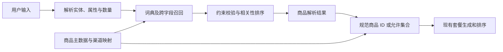

# 商品模糊检索与需求解析调研

调研日期：2026-09-07。依据当前工作区代码、仓库商品导入样本和官方技术资料。本文提出待实施方案；未修改运行代码、安装搜索组件或验证线上商品库存。

建议先实现 **领域词典驱动的查询解析＋跨字段约束匹配＋有范围的别名/概念扩展＋分层排序**，字符相似度负责补漏。实现位置是 `ProductResolver`，位于自然语言需求与现有套餐推荐引擎之间。向量检索可在真实长尾查询证明有收益后加入。

## 1. 项目现状与可复现问题

当前技术栈为 Go 1.25、PostgreSQL，未引入分词或向量依赖；Docker 构建使用 `CGO_ENABLED=0`。

代码依据：

- [商品模型](../internal/domain/product/product.go#L40)：已经有品牌、名称、规格、品类、别名；一条 Product 表示一个品牌下一个具体规格的单品。
- [商品查询](../internal/application/products/service.go#L118)：全量加载后过滤；整个 query 必须是 ID、名称、规格或某一条别名的子串。自由文本不检索 category 和 description；category 参数另外做精确过滤。结果按品牌、名称、规格、ID 排序，没有相关性评分。
- [商品仓储](../internal/adapters/outbound/postgres/product_repository.go#L69)：直接 SELECT 全表，没有数据库搜索索引调用。
- [推荐请求](../internal/domain/recommendation/session.go#L45)：已有 `query`、`resolvedProductId`、`allowedProductIds`，适合接收解析结果。
- [推荐引擎匹配](../internal/domain/recommendation/engine.go#L313)：对规范 ID 做相等比较；没有已解析 ID 时将 query 当成 ID 候选，不执行中文语义解析。
- [MCP 目录工具](../internal/adapters/inbound/mcpserver/server.go#L110)：调用现有商品查询，然后由调用方写入需求 ID。

对[商品导入文件](../data/product-imports/2026-09-06-mcd-hamburgers/products.json)中的 14 条记录，用 Python 按现有子串判断逻辑复现；这是离线样本结果，不代表生产数据库规模，也不是新算法实测：

| 输入 | 当前命中数 | 观察 |
| --- | ---: | --- |
| 汉堡 | 4 | 样本里有 13 条 category=汉堡；遗漏巨无霸、麦香鸡、麦香鱼等 |
| 堡 | 10 | 仍遗漏名称、别名中都没有“堡”的三款汉堡 |
| 鸡腿堡 | 2 | 命中板烧鸡腿堡，以及已有“麦辣鸡腿堡”别名的麦辣鸡腿汉堡 |
| 鸡扒堡 | 0 | 没有对应词面或别名 |

另外构造 `name=豆浆, specification=小杯, category=饮品, aliases=[豆奶]` 的示意数据：`豆奶` 可命中，`小份豆浆`、`豆浆小份`、`小份豆奶` 均不命中。本次检查的上述导入样本没有豆浆，不能据此声称当前门店售卖任何豆浆规格。

## 2. “小份豆浆”：解析意图，跨字段共同满足

目标解析结构示意：

```json
{
  "originalQuery": "小份豆浆",
  "concept": "soy_milk",
  "attributes": {"size": "small"},
  "quantity": 1,
  "unmatchedTerms": []
}
```

`soy_milk` 等是拟议内部概念代码，不是现有字段或产品 ID。“豆浆”可以是商品名称或细分概念，不能假设现有 category 就保存“豆浆”；当前数据的 category 可能只写“饮品”。

处理流程：

1. 做 Unicode 规范化、空白清理、英文字母大小写归一，保留原始输入。
2. 识别已知完整商品名、别名、规格词及其位置，区分商品词、规格和数量。例如“小份”是规格，“两份”通常是数量；含“大”“小”的完整商品名不能被简单正则误拆。
3. 将豆浆映射到商品家族/概念，将“小份”映射到该品牌、该商品家族允许的 `size=small`。仅在有菜单依据时把“小杯”视作该家族的小规格；不同家族的“小份”和“小杯”不能全局互换。
4. 对同一个具体规格 Product 执行 `概念匹配 AND 规格匹配`。不能将一个 SKU 的豆浆与另一个 SKU 的小规格拼成一次命中。
5. 商品仅有“标准份”或“250ml”而缺少大小对应依据时，保留规格未知状态，不猜成小杯。

实体与规格都明确时，它们属于约束，不能因为大杯商品字面更相似就超过小杯。没有满足规格的单品时返回无精确匹配；如展示其他规格，应作为明确标注的备选，不能自动写入满足原需求的 ID 集合。

只拼接字段再做 Contains 仍会受“小份豆浆/豆浆小份”词序影响；把所有词改成 OR 则可能只因“小份”召回小份薯条。应采用**不同语义槽位之间 AND，同一个槽位的等价表达之间 OR**。

Elastic 的 `combined_fields` 提供“每个查询词可以出现在任意参与字段”的检索模式，可作为跨字段召回参考；结构化规格、品牌等约束仍应独立过滤。该查询要求参与文本字段使用相同的搜索 analyzer。[官方说明](https://www.elastic.co/docs/reference/query-languages/query-dsl/query-dsl-combined-fields-query)

## 3. “豆奶”：区分别名、同义概念与可替代品

推荐将映射分成三类：

| 关系 | 示例 | 使用方式 |
| --- | --- | --- |
| 商品别名 | 麦辣鸡腿堡 → 麦辣鸡腿汉堡 | 绑定已知商品或商品家族，规格单独选择 |
| 有条件的概念映射 | 特定品牌菜单语境中，豆奶 → 豆浆概念 | 扩展候选，保留原始词和映射来源 |
| 可替代关系 | 用户允许其他植物饮品 | 进入替代推荐策略，不作为同一商品认定 |

现有 `aliases` 能处理单品别名；为避免每个规格重复维护，建议增加共享概念词表，包含 `term, conceptID, relation, brandScope, categoryScope, source, version`。可先用版本化配置文件，后续再做运营表。

不应全局断言“豆奶=豆浆”：如果菜单同时有两个不同商品，保留“豆奶”的直接命中优先级，豆浆仅作为扩展候选。查询未提供糖度、温度或规格时不能从同义词里偷偷补入。

查询扩展优先使用受控词典；未知口语可走低优先级语义召回，再由候选商品属性校验。LLM 可帮助提取表达或离线建议词表，但最终 ID 必须来自目录候选。

Elastic 的同义词机制明确区分等价词组和有方向的映射，`synonym_graph` 支持多词同义表达。可借鉴关系建模，无需为这一能力立即部署 Elasticsearch。[官方说明](https://www.elastic.co/docs/reference/text-analysis/analysis-synonym-graph-tokenfilter)

## 4. “汉堡、堡、鸡腿堡、鸡扒堡”：多粒度识别与品类层级

这些词同时涉及缩写、上位品类、具体肉类和商品名称。单靠把词切开，不能得出正确的商品集合。

建议词典保留完整词和解释结构，例如：

```text
汉堡     → category:burger
堡       → category:burger（点餐语境中的独立简称）
鸡腿堡   → category:burger + cut:chicken_thigh
鸡扒堡   → category:burger + filling:chicken_patty
板烧鸡腿堡 → 已知商品家族 + 经目录确认的属性
```

这里的属性与映射是设计示意，需要品牌菜单确认。“鸡扒”和“鸡排”也应按业务词表确认；不能把“鸡腿”“鸡扒”“鸡肉”统一成全局等价词。

- 输入“汉堡”或独立的“堡”：通过品类成员关系召回巨无霸、麦香鸡、麦香鱼等，名称不必含“堡”。
- 输入“鸡腿堡”：优先命中已确认鸡腿部位的汉堡，不能因为同属鸡肉汉堡就自动把麦香鸡认作满足需求。
- 输入“鸡扒堡”：召回经确认符合该馅料概念的商品；如果目录只有含糊描述，就保留候选或返回无法确定，不硬绑定板烧鸡腿堡。
- 输入“板烧鸡腿堡”：完整商品名作为强证据；同时保留内部的鸡腿/汉堡概念用于索引，避免强行选一种切分后丢失信息。
- “汉堡”作为品类和“汉堡包”作为具体商品可能重叠：单独输入上位词通常返回多款候选，不能因为某个名字接近就自动选中它。

实现建议：已知商品与属性词先用 Trie 做多粒度匹配，保留重叠词位置；对歧义结合完整实体、领域词权重和槽位覆盖做路径选择。未知片段可用通用中文分词补充。MVP 不必立即训练分词模型。

在 Go 项目中可优先评估 GSE：它提供自定义词典、搜索模式和 HMM 等能力；接入时要验证现有禁用 CGO 的构建、词典打包、加载内存及并发行为。另一参考是 jieba 的自定义词典和搜索模式，但直接接入 Python 会增加服务或运行时边界。两者都不能自动替项目维护品牌商品语义。[GSE 官方仓库](https://github.com/go-ego/gse)、[jieba 官方仓库](https://github.com/fxsjy/jieba)

索引侧保留“完整实体＋确认的子概念”，查询侧保留“完整实体优先＋备用解析路径”。重叠词是同一证据的不同粒度，不能把“鸡腿堡、鸡腿、堡、汉堡”当成四个独立命中重复加分。扩展出的词也不是四个必须同时出现的原始查询词。

## 5. 算法取舍与排序

| 方法 | 适合解决 | 局限 | 本项目定位 |
| --- | --- | --- | --- |
| Trie/领域词典＋属性规则 | 已知商品、简称、规格、数量 | 需要维护词表及歧义规则 | 第一阶段核心 |
| 概念映射＋品类层级 | 豆奶等口语、堡等简称、上位词召回 | 需区分等价、上下位、替代 | 第一阶段核心 |
| 多字段倒排＋BM25/BM25F | 多词相关性和更大商品目录 | 不会自行理解同义或硬规格 | 数据量、QPS 和实测需要时加入 |
| 字符 2-gram/3-gram＋编辑距离 | 少量错字、局部字面重合 | 短词误召回大，无可靠语义 | 低优先级补漏 |
| PostgreSQL pg_trgm | 已有数据库内的字面近似召回 | 无中文领域理解，短查询索引能力受限 | 可选工程优化 |
| 向量召回＋重排 | 未收录口语、描述式长尾查询 | 需推理服务和效果评估，不能保证规格 | 后续可选 |
| 协同过滤 | 有行为历史的个性化偏好排序 | 不解决查询词到商品身份的解析 | 不作为这三个问题的核心算法 |

对于字符补漏，可用相邻字符 bigram 的 Dice 分数 `2×交集大小/(两集合大小之和)`，与按 Unicode 字符计算的编辑距离辅助判断。单字“堡”走受控简称规则；双字词通常先精确/词典匹配，不能宽泛允许一个字的编辑误差。长度限制和阈值需要按错字样本校准。

`pg_trgm` 按字符三元组计算字面相似度，并提供 GiST/GIN 索引支持；不能用相似度阈值代替“豆奶→豆浆”的业务语义。官方还指出，LIKE/正则没有可提取三元组时会退化到完整索引扫描，不能承诺 `%堡%` 等短词高效。部署前在实际编码和 locale 上检查 `show_trgm` 与查询计划。[PostgreSQL 官方文档](https://www.postgresql.org/docs/current/pgtrgm.html)

建议采用可解释的分层排序，先过滤硬约束，再排序：

1. 确认的完整商品名/别名匹配，且所有显式属性满足。
2. 全部查询语义槽位覆盖的概念、品类匹配。
3. 符合属性约束的字符或语义近似候选，明确保留不确定性。

同层可按实体精确度、原始词覆盖、字段证据、扩展代价、相关性得分排序，最后用 ID 稳定打破平局。别名和词典扩展不重复计分，描述中的原料提及不能直接代替商品类型；“豆浆粉蛋糕”不因含“豆浆”就变成豆浆饮品。明确规格冲突应排除，不能只减几分。

如后续引入向量，可选择支持中文/多语言检索的 BGE-M3 作为待测基线，而非宣称其对本项目最优。它支持 dense、sparse 和多向量检索。[原作者模型说明](https://huggingface.co/BAAI/bge-m3)

词面与向量结果可用 RRF 按排名融合，避免直接混加不同量纲分数；仍需在融合结果上检查约束，并保留精确匹配优先策略。RRF 分数不是自动解析正确率。[RRF 官方说明](https://www.elastic.co/docs/reference/elasticsearch/rest-apis/reciprocal-rank-fusion)

## 6. 推荐的项目接入方案



建议新增应用层 `ProductResolver` Port 和结果类型，包含原始查询、解析槽位、候选 ID、匹配原因、未匹配词、词典版本、`resolved/ambiguous/not_found` 状态。这里的状态需要区分“品类查询正常返回多个商品”和“商品身份无法确认”的歧义。

只有唯一、证据充分的具体商品解析才填 `resolvedProductId`。用户明确表达“任意汉堡”这样的可选集合时，可以将符合语义的完整可接受集合写入 `allowedProductIds`；该集合不能简单等于 UI 展示的 Top-K 搜索结果，否则可能漏掉更合适或更便宜的套餐。歧义导致的多个候选也不能直接当成用户同意互相替代。

建议保留现有全量目录 List 契约，新增面向排序与解析的搜索用例/API/MCP 工具。现有 HTTP、MCP 都复用解析层，避免不同入口出现不同词表和匹配规则。暂时可以对一次加载的目录快照处理；持续数据量或 QPS 增长后再下推 PostgreSQL 倒排查询，不能对当前未知线上规模作容量承诺。

关键配套工作：

- 商品主数据补充 `family/concept`、可验证的 `size/temperature/sugar/...`，保留现有显示用 specification；缺失属性保持未知。
- 建立标准 Product ID 与渠道商品代码、规格/选项的映射。[当前菜单转换](../internal/adapters/outbound/mcdmcp/adapters.go#L246)在上游缺少 canonical ID 时回退到商品名称；因此仅改善搜索，仍不能保证其与本地 Snowflake ID 在推荐引擎中对齐。
- 同样解析 mustHave、niceToHave、exclude。排除项未能解析时不能静默丢弃；模糊扩展也不能把很窄的排除项无依据扩大为整个品类。
- 商品可被搜索到与当前门店可购买分开处理，库存、时段和渠道价格仍由供给层确认。
- 索引及缓存必须随商品新增、别名修改、状态修改、规格修改、词典版本更新而失效或重建。单品解析结果保留主数据和词典版本，便于排查。

## 7. 验收与推进顺序

先标注真实查询集，包含输入、品牌/上下文、允许商品集合、禁止商品集合、显式属性和是否允许自动解析。以下是验收设计，尚无新算法效果测量：

| 查询 | 期望 | 必须避免 |
| --- | --- | --- |
| 小份豆浆、豆浆小份 | 已确认的小规格豆浆 | 大规格豆浆、小份薯条 |
| 小份豆奶 | 在适用品牌同义规则下命中小规格豆浆/实际豆奶 | 丢失规格、越过品牌规则 |
| 豆奶，目录同时有豆奶和豆浆 | 原词直接命中优先，保留商品差异 | 全局合并成一个商品 |
| 汉堡、堡 | 返回完整汉堡品类候选，含名字不带堡的成员 | 漏掉巨无霸、麦香鱼、麦香鸡 |
| 鸡腿堡 | 已确认的鸡腿汉堡集合 | 鸡腿小食、未经确认的其他鸡肉汉堡 |
| 鸡扒堡 | 菜单证实的相应商品或明确的不确定结果 | 无依据绑定板烧鸡腿堡 |
| 板烧鸡腿堡 | 完整实体优先 | 只按“鸡/堡”宽泛匹配 |
| 两份小杯豆浆 | 数量 2、size=small | 把“两份”识别为规格 |
| 无糖豆浆 | 已确认无糖的豆浆 | 糖度未知时擅自当成无糖 |
| 不要鸡腿堡 | 解析为有依据的排除集合 | 忽略“不”、把所有汉堡排除 |

评估至少覆盖：商品族/规格槽位准确率、Recall@K、MRR/nDCG、显式约束违反率、自动解析精确率和覆盖率、零结果率、P95 延迟，以及变更后的索引一致性。品类词另外评估可接受集合覆盖率，不能只看前几个结果。对“拒绝自动解析”的样本单独统计，避免靠全部拒答获得虚高精确率。

先跑当前子串基线，再依次比较“领域规则”“规则＋字符补漏”“规则＋语义补漏”，按规格、简称、同义词、错字、歧义分组评估。词表开发样本与留出查询集分离，阈值及权重只在开发集调整；线上性能、模型收益均需实测。

推进顺序：

1. 补齐商品家族、品类词和规格归一规则，建立上述查询标注集。
2. 实现共享 ProductResolver、跨字段 AND 匹配与分层排序，打通规范 ID/渠道代码映射。
3. 基于剩余失败查询加入字符补漏；如数据库过滤成为瓶颈再评估索引方案。
4. 长尾语义查询仍有明显漏召回时，评估向量和重排服务的收益与延迟。

第一阶段即可覆盖用户提出的三类问题的主要机制；实际覆盖程度取决于商品数据和词表质量，不能由更换分词器单独保证。
